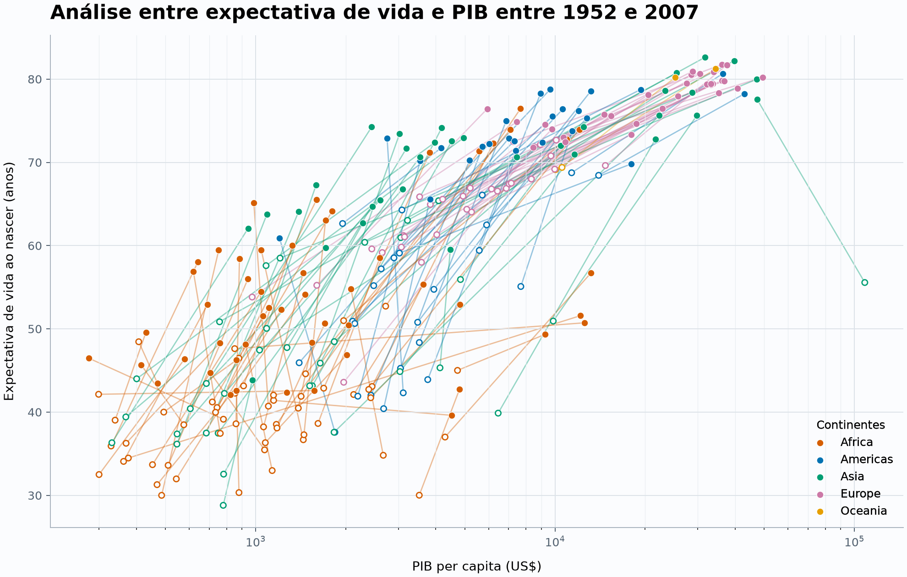

# Relatório

> [!CAUTION]
>
> - Você <ins>**não**</ins> **pode utilizar ferramentas de IA para escrever este relatório**.

## Identificação

- **Nome**: <mark>`Leonardo Greco Fin`</mark>
- **Cartão UFRGS:** <mark>`00595687`</mark>

## Dados utilizados

> [!IMPORTANT]
>
> - Os dados utilizados devem ser informados como **links** para as fontes originais.
> - Se houver mais de um conjunto de dados, liste todos separadamente.
> - Para cada conjunto de dados, inclua também uma **descrição curta** explicando os dados.

1. **Dataset 1**: <mark>`<https://www.gapminder.org/data/>'</mark>
    * **Descrição curta**: <mark>`O dataset é um recorte que contém dados de 142 países entre 1952-2007 em intervalos de cinco anos (apesar da comparação ser somente entre os pontos de início e final do estudo). Os atributos do dataset incluem: país, continente, ano, expectativa de vida ao nascer, população e PIB per capita (sendo que este último é expresso em dólar estadunidense ajustados pela inflação.)`</mark>

 

## Código-fonte da visualização

> [!IMPORTANT]
>
> - Indique abaixo onde está, dentro deste repositório, o código-fonte usado para gerar a visualização.

- **Arquivo principal**: <mark>`plot_gapminder.py`</mark>
- **Arquivos complementares (se houver)**: <mark>`data/gapminder.tsv (contém os dados) e requirements.txt (contém as dependências necessárias)`</mark>

## Imagem da visualização gerada

> [!IMPORTANT]
>
> - Insira aqui uma imagem da visualização criada por você. Troque `imagem-da-visualizacao.png` pelo caminho correto do arquivo no repositório. 
> - Se você criou alguma visualização interativa, então descreva aqui como acessá-la. Por exemplo, se for uma página HTML, coloque o link, ou se for uma visualização 3D, descreva como compilar e executar o código. 

## Descrição da visualização

### Legenda (*caption*)

> [!IMPORTANT]
>
> - Escreva um texto curto explicando como interpretar a visualização. Descreva os elementos visuais, eixos, cores, símbolos ou interações relevantes.
> - Este texto seria a legenda (*caption*) que acompanharia a figura em uma publicação, por exemplo.

<mark>`O gráfico representa a expectativa de vida ao nascer e o PIB per capita em 142 países comparando entre os anos de 1952 e 2007. Nesse contexto, cada país é representado por um círculo branco em 1952 (ponto inicial do estudo) e um ponto colorido em 2007 (ponto final do estudo). As linhas conectam as duas observações, mostrando a diferença das estatísticas, enquanto as cores indicam o continente do país em 2007 conforme a legenda na imagem, mudando o foco dos países para o continente de que pertencem. O eixo Y (vertical) representa a expectativa de vida em anos, e o PIB per capita representa o eixo X (horizontal), em dólar estadunidense considerando a inflação, em escala logarítmica.`</mark>

### Conclusão demonstrada pela visualização

> [!IMPORTANT]
>
> - Escreva uma conclusão curta sobre os dados com base na visualização.
> - Explique qual insight, padrão ou tendência pode ser observado.

<mark>`O gráfico nos permite fazer uma análise do contexto histórico e social dos diferentes continentes e suas evoluções. A relação entre riqueza e longevidade não é tão simples nem uma consequência direta uma da outra, mas uma soma de fatores sociais e históricos. A Europa, por exemplo, partiu de uma base mais alta e, apesar de exibir ganhos moderados de longevidade, é evidente um estancamento maior em comparação à Ásia que, partindo de uma base similar a da África, foi capaz de um salto de PIB/longevidade absurda comparando-se agora a países europeus. Por outro lado, a África, partindo de uma base similar no gráfico, possui ganhos mais ambíguos, com um aumento geral na expectativa de vida, mas um estancamento maior da economia, sugerindo que legados coloniais, guerras e entre outros retardam o progresso do continente africano, e causa divergências internas maiores. Enquanto isso, as Américas possuem trajetos mais estáveis e ascendentes, mantendo um certo padrão sem mudanças drásticas. Portanto, apesar que à primeira vista riqueza indica longevidade, na realidade fatores externos como política e história determinam quanto dessa riqueza é, ou não, convertida em longevidade.  `</mark>

